# Architecture

A fixed six-stage sequence, coordinated by code ([`run.py`](../run.py)). Code decides what runs next, owns record
accounting, validation, budgets, retries and arithmetic. Models only answer bounded language questions inside four
distinct roles (enrich, verify, group, memo), each with its own instructions, inputs, outputs and saved evidence.

```mermaid
flowchart TD
    CSV[("Input CSV<br>any path")] --> ING
    subgraph S1["1 Prepare - code only"]
      ING["ingest.py<br>multiline-safe parse, row SHA-256,<br>profile, exact-duplicate texts,<br>quarantine 13 empty texts"]
    end
    ING -->|"state.sqlite: source + records(pending)<br>ingestion.json, ingestion_report.json"| CACHE
    subgraph S2["2 Classify - ENRICHER role"]
      CACHE{"exact-text result cache<br>same label_config?"} -->|hit| COPY["copy labels<br>cache_source_id = original"]
      CACHE -->|miss| Q["queue of distinct texts<br>batches of at most 50"]
      Q --> LED{"spend ledger:<br>spent + reserved + next <= cap?"}
      LED -->|no| STOPB["stop dispatch, save, exit<br>(rows stay pending)"]
      LED -->|yes| W["N parallel workers<br>GPT-6 Luna, effort none, Flex tier,<br>stable prompt prefix (provider cache)"]
      W -->|"429 / timeout"| RETRY["bounded retry, backoff + jitter"] --> W
      W -->|"400 content-policy refusal"| BIS["bisect batch until the<br>refused review is isolated"]
      BIS --> FBJ["Jev cross-provider fallback"]
      W -->|JSON| VAL["code validation: every ID returned,<br>enums, ranges, subtopic in topic,<br>exact-substring quote, severity rule"]
      VAL -->|invalid item| R1["retry once"] --> VAL2{"valid?"}
      VAL2 -->|no| FB["capped stronger-model fallback<br>(GPT-5-mini, max 0.2% of rows)"]
      FB -->|still invalid| QUAR["quarantine with reason + attempts"]
      VAL -->|valid| SAVE["atomic save after every batch<br>(SQLite transaction)"]
      VAL2 -->|yes| SAVE
      FB -->|valid| SAVE
      FBJ --> SAVE
    end
    SAVE --> EXP["enriched.jsonl.gz + quarantine.jsonl"]
    COPY --> SAVE
    EXP --> VER
    subgraph S3["3 Verify - VERIFIER role (different provider)"]
      VER["seeded random sample of original records<br>Jev re-labels from text + rubric only<br>(never sees the enricher's labels)"] --> CMP["code compares fields<br>verify_report.json, disagreements.csv"]
    end
    CMP --> GRP
    subgraph S4["4 Group - code membership + GROUPER role"]
      GRP["membership.csv: every completed<br>complaint/cancellation -> issue_id = topic.subtopic"] --> NAME["GPT-5-mini names each issue from a<br>bounded seeded sample of quotes;<br>unknown IDs rejected; misfits flagged"]
    end
    NAME --> RNK
    subgraph S5["5 Rank - code only"]
      RNK["priority = complaint_count x mean_severity = severity_sum<br>sort: score desc, issue_id asc<br>ranking.csv, aggregates*.csv"]
    end
    RNK --> MEMO
    subgraph S6["6 Recommend - MEMO role"]
      MEMO["code builds claims table (C/A/K IDs) + evidence pack"] --> MW["GPT-5-mini writes memo from the pack only"]
      MW --> CHK{"code check: every number is a claim value,<br>every claim/review ID exists"}
      CHK -->|violations| MW2["one rewrite with violations listed"] --> CHK2["save; warn if still failing"]
      CHK -->|pass| OUT["memo.md + claims.csv"]
    end
    OUT --> GRD["export: grading/ (contract format)"]
```

## Roles, inputs, outputs, failure behavior

| Stage | Owner | Input | Output (saved handoff) | Failure behavior / stop condition |
|---|---|---|---|---|
| 1 Prepare | code | input CSV path | `state.sqlite`, `ingestion.json` (course helper), `ingestion_report.json` | refuses a run dir built from a different file (checksum) |
| 2 Enrich | **ENRICHER** model: GPT-6 Luna (`enrich_v2`); code validates | distinct pending texts, at most 50 per request, review text only | `records` rows (completed/quarantined), `enriched.jsonl.gz`, `quarantine.jsonl`, `calls.jsonl` | invalid item: 1 retry, then capped fallback, then quarantine; transport errors: up to 6 attempts with backoff; 5 consecutive failed batches, spend cap, STOP file or Ctrl+C: stop dispatch, finish in-flight, save, exit |
| 3 Verify | **VERIFIER** model: Jev `jev-1.13.0` (`jev_verify_q1`); code compares | seeded 0.4% sample (20 to 2,000) of completed original records, text only | `verify/verifier_predictions.jsonl`, `verify_report.json`, `disagreements.csv` | a failed item stays unverified (logged); resume skips already-verified IDs |
| 4 Group | code (membership) + **GROUPER** model: GPT-5-mini (`group_v1`) | completed complaint/cancellation records; at most 12 sampled quotes per issue | `group/membership.csv`, `group/issues.json`, `group/group_input_packs.json` | model failure: taxonomy names used; invented issue IDs or review IDs rejected; reused on unchanged inputs (fingerprint) |
| 5 Rank | code | `enriched.jsonl.gz` + `membership.csv` | `rank/ranking.csv`, `aggregates*.csv` | invalid membership row raises an error (no silent drops) |
| 6 Recommend | code (claims, checks) + **MEMO** model: GPT-5-mini (`memo_v1`) | claims table + bounded evidence pack (top-8 issues x 3 quotes) | `memo/memo.md`, `memo/claims.csv`, `memo/memo_output.json` | claim-check violations: one rewrite, then saved with a visible warning |

## Why each model call is needed, and what code does instead

- **Enricher:** topic, intent, severity and sentiment require reading messy, multilingual customer language; keyword rules cannot handle negation, sarcasm or the precedence rules. Code does everything else: duplicate detection, the evidence quote for reviews of 200 characters or fewer, entity extraction (explicit term match), the severity consistency rule, ID checks and quote-membership checks.
- **Verifier:** an independent second opinion is the only way to estimate label reliability at scale without human labels on every row. A different provider and method (Jev choice probabilities) reduces shared blind spots; code does the comparison.
- **Grouper:** issue membership is deterministic (`topic.subtopic`), so ranking never needs a model. The model only writes human-readable names and flags misfit samples for inspection.
- **Memo:** turning a ranked table into a short argument is a language task, but the model sees only aggregates and a bounded evidence pack. Code owns every number (claims table) and rejects unsupported numbers or IDs.

## Cost and scale techniques

| Technique | Where |
|---|---|
| Exact-text result caching | 660,609 nonempty rows collapse to 484,189 distinct texts; duplicates reuse the original's validated labels with `cache_source_id` provenance, keyed by `label_config` |
| Multi-review batching | at most 50 reviews per enrichment request amortizes instructions over 50 reviews |
| Provider prompt caching | the long rubric is a stable prefix (`prompt_cache_key=enrich_v2`); cached input is billed at 1/10 |
| Discounted queue tier | OpenAI Flex processing (50% of standard), with backoff on "Flex temporarily unavailable" 429s |
| Compact output | short JSON keys; code supplies quotes for short reviews and entities, cutting billed output tokens |
| Parallel workers + shared ledger | 16-24 workers share one spend ledger that reserves worst-case cost before dispatch |
| Queue + saved state | SQLite work queue with atomic per-batch saves; interruption and resume never re-pay for completed IDs |
